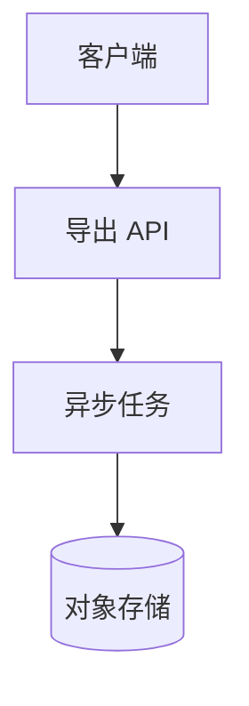
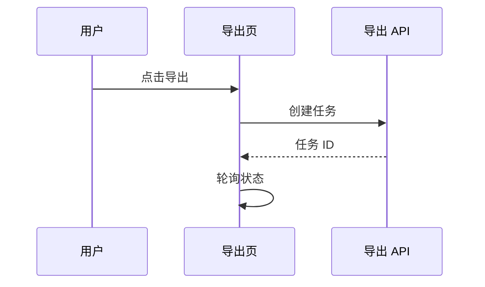
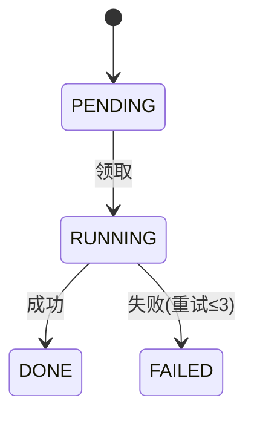
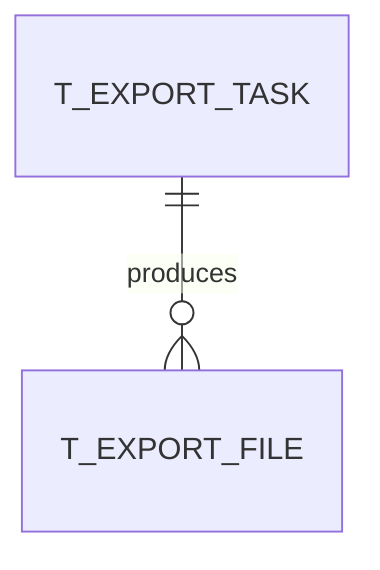

# 文档模板（H2 标题与 dd.py MANIFEST_DEFAULTS 严格同文，勿改标题文字）

两份文档都是 LLM 产出的用户可见交付物。共同规约：

- H1 标题下一行写状态行：`状态: Draft`（confirm 成功时 dd.py 自动同步为 `状态: Confirmed`；勿手改状态行）。
- 复杂逻辑用 mermaid 表达（选型见 `mermaid-uml.md`）；**禁止整段实现代码**；伪代码仅算法必要处且 ≤10 行并附一句说明。
- 未决问题显式标注 `[未决:Qxxx]`；延期问题标注 `[延期:Qxxx]`（check 门禁与台账对账）。
- 不出现任何占位符禁词（枚举见 dd.py `PLACEHOLDERS`，出现即门禁 FAIL）；所有示例省略号 `……` 落笔时必须替换为实质内容。

## 需求分析文档骨架（requirements-analysis.md）

````markdown
# <特性名> 需求分析

状态: Draft

> 一段话：这个特性解决什么问题、为谁解决、成功的样子。

## 背景与目标

（真实目标一段：为什么做这件事、不做会怎样）
可度量目标：
- 目标 1（可验证的度量，如：导出 10 万行 ≤ 30s）
- 目标 2

## 范围：IN 与 OUT

| IN（本期做） | OUT（明确不做 / 后续迭代） |
|---|---|
| …… | …… |

（OUT 项写清楚"为什么不做"；被裁剪出范围的延期问题也归档到这里）

## 现状与事实调研

（开头一句知识库模式：primary 及各可用来源；随后列关键事实，每条带出处）
- 事实：src/jobs/ 已有 3 个同类异步任务（出处：codegraph / 直接读码）
- 事实：现有表 t_order 没有 export_state 列（出处：schema 目录）

## 术语表

（本特性引入或涉及的关键术语；一个概念只留一个词，其余进 Avoid）

**导出任务**:
一次异步生成导出文件的生命周期单元。
_Avoid_: 导出流水、export flow

**……**:
定义一句（定义它是什么，不定义它做什么）。
_Avoid_: 别名1、别名2

## 决策表

| 问题ID | 问题 | 决策 | 依据 | ADR |
|---|---|---|---|---|
| Q001 | 导出同步还是异步 | 异步任务 | 数据量可达 10 万行，同步必超时 | ADR-0001 |
| Q002 | …… | …… | 事实/权衡一句话 | — |

（过三重门的决策才有 ADR 列引用；其余写 —）

## 未决与延期

（延期问题逐条列出：影响面 + 何时必须回答）
- [延期:Q003] 是否支持 CSV 以外格式 —— 影响导出引擎接口抽象；上线前必须回答
````

## 详细设计文档骨架（design.md）

````markdown
# <特性名> 详细设计

状态: Draft

## 功能概述

（一段话说清本特性做什么；随后特性列表；最后一张架构总览图）
- 特性点 1 / 特性点 2 / 特性点 3



## UI 与页面交互

（页面/组件清单表 + 关键交互说明；无 UI 的项目在 manifest 停用本节）

| 页面/组件 | 作用 | 关键状态（加载/空/错误） | 权限 |
|---|---|---|---|

关键交互（复杂交互配时序图）：



## 核心逻辑说明

（按子域拆 H3 小节；每小节一张图 + 一段文字：图前一句"这张图回答什么"，图后一句结论）

### <子域 1：如 导出任务状态机>



### <子域 2>

## 接口设计

（每个接口一行表格 + 一行签名；禁止写实现体）

| 接口名 | 方法与路径 | 入参 | 出参 | 错误码 |
|---|---|---|---|---|
| 创建导出任务 | POST /api/exports | orderId, format | taskId | 400/409 |

签名：`ExportTask createExport(String orderId, Format fmt)`

## 数据库设计

（表结构表格 + erDiagram + 索引与迁移说明）

**t_export_task**

| 列 | 类型 | 约束 | 说明 |
|---|---|---|---|
| id | BIGINT | PK | |
| order_id | BIGINT | IDX | |



迁移：新增表 t_export_task；t_order 不改动。

## 缓存设计

（缓存什么 / 键规约 / TTL / 失效策略 / 一致性级别；无缓存层则停用本节）

## 非功能性设计

**容量**：（量级估算：QPS / 行数 / 存储增长）
**性能**：（预算：接口 P99 ≤ x ms；慢路径与规避）
**安全**：（鉴权/越权/敏感数据/注入面）
**可观测**：（关键指标、日志、告警阈值）

## 灰度与回滚

（开关 / 分级放量 / 回滚步骤 / 数据回滚；不适用则停用本节）

## TDD 测试用例

（TC-xxx 编号；覆盖核心路径 + 边界 + 异常；建议覆盖非功能场景；实现阶段先写这些用例再写实现）

| 用例ID | 场景 | Given | When | Then | 对应设计章节 |
|---|---|---|---|---|---|
| TC-001 | 正常创建导出 | 订单存在 | 创建任务 | 返回 taskId，状态 PENDING | 核心逻辑说明 |
| TC-002 | 边界：数据量为 0 | 订单无明细 | 创建任务 | 直接 DONE，文件为空 | 核心逻辑说明 |
| TC-003 | 异常：重试耗尽 | 任务失败 3 次 | 第 4 次执行 | 终态 FAILED，触发告警 | 核心逻辑说明 |

## 决策与 ADR 索引

| ADR | 标题 | 关联问题 |
|---|---|---|
| ADR-0001 | 导出走异步任务 | Q001 |
````

## ADR 模板（docs/adr/NNNN-slug.md，路径由 dd.py q-answer --adr 分配）

````markdown
# <短标题>

<1-3 句：上下文是什么、决定了什么、为什么。一个 ADR 可以只有这一段。>
````

可选段（确有价值才加）：

````markdown
Status: accepted

## Considered Options
- 方案 A：……（弃：……）
- 方案 B：……

## Consequences
- 正面：……
- 负面/代价：……
````

写 ADR 的准入三重门（全中才写，否则决策只进决策表）：**难逆转**（事后改主意代价大）/ **无上下文会困惑**（未来读者会问"为什么这么做"）/ **真实权衡**（存在真实备选且因具体理由选了它）。
